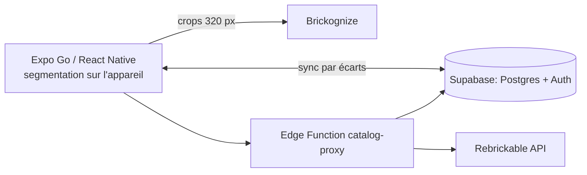

# 🧱 BrickHeap

[](https://github.com/ycocatrix/BrickHeap/actions/workflows/ci.yml)
[](LICENSE)
[](https://github.com/ycocatrix/BrickHeap/issues)
[](https://github.com/ycocatrix/BrickHeap)

**Scannez une brique ou tout un tas de briques : BrickHeap les identifie et construit votre inventaire.**
Application mobile open source (iOS & Android), 100 % basée sur des offres gratuites.

## Fonctionnalités

- **Scan unitaire ou de pile** : détection multi-briques sur l'appareil, cadres interactifs mis à jour par instantanés.
- **Mode Explorer** : touchez une brique pour voir sa fiche, sans rien enregistrer.
- **Mode Inventorier** : capture d'une pile, regroupement par pièce + couleur (`3× Brique 2×4 Rouge`), ajustement, ajout en un clic.
- **Fiche officielle** : nom, Design/Element ID, couleur, sets compatibles, lien *Pick a Brick*.
- **Inventaire local, synchronisé si vous avez un compte** (Supabase) : multi-appareils, listes/projets, mode sans compte complet.
- **Export** CSV, JSON, BrickLink XML.
- **Mode Calibration** : comparer détection IA et vérité terrain sur vos vraies briques.

## Architecture



Détails : [docs/ARCHITECTURE_CLOUD.md](docs/ARCHITECTURE_CLOUD.md) · [docs/FUNCTIONAL_SPECS.md](docs/FUNCTIONAL_SPECS.md) · [docs/UX_UI_MOCKUPS.md](docs/UX_UI_MOCKUPS.md) · [maquettes (HTML)](docs/mockups-preview.html) · [plan d'implémentation](docs/IMPLEMENTATION_PLAN.md) · [tests sur appareil](docs/DEVICE_TEST_SCRIPT.md)

## Installation rapide

Prérequis : Node 20+, l'app **Expo Go** (SDK 58) sur vos téléphones (iOS/Android).

```bash
git clone https://github.com/ycocatrix/BrickHeap.git
cd BrickHeap
npm install
cp .env.example .env     # optionnel : URL + clé publishable Supabase (sans clés : mode sans compte)
npx expo start           # scannez le QR code avec Expo Go (iOS: app Caméra)
```

Les téléphones doivent être sur le même Wi-Fi ; sinon `npx expo start --tunnel`.

Pour déployer votre propre backend (projet Supabase gratuit) : clé **publishable** dans
`EXPO_PUBLIC_SUPABASE_PUBLISHABLE_KEY`, `npx supabase db push` (migrations), `npx supabase secrets set
REBRICKABLE_API_KEY=…`, `npx supabase functions deploy catalog-proxy delete-account --use-api`. Le SMTP intégré de
Supabase n'envoie qu'aux adresses de l'équipe : configurez un SMTP gratuit pour les autres utilisateurs. Étapes
détaillées : [docs/DEVICE_SETUP.md](docs/DEVICE_SETUP.md).

## Contribuer

Voir [CONTRIBUTING.md](CONTRIBUTING.md). Ne commitez jamais de clés (`.env` est ignoré).

## Mention légale

BrickHeap est un projet open source communautaire et indépendant. Il **n'est pas affilié, sponsorisé ni approuvé par The LEGO Group**. LEGO® est une marque déposée de The LEGO Group. Les données de catalogue proviennent de Rebrickable et l'identification de Brickognize, selon leurs conditions d'utilisation respectives.

## Licence

[MIT](LICENSE) © ycocatrix
