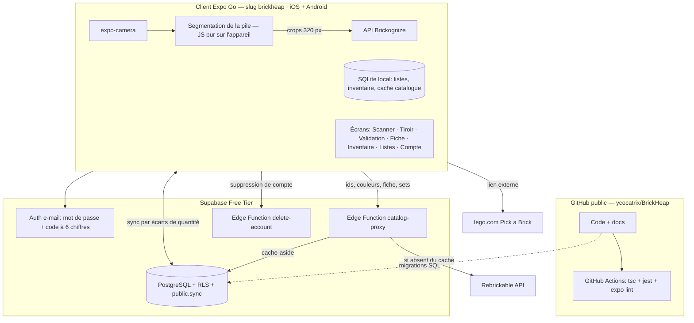

# Architecture technique & cloud — V1 (100 % gratuit)

Les choix détaillés (décisions D1–D20, contrats, plan de test) sont dans
[`IMPLEMENTATION_PLAN.md`](IMPLEMENTATION_PLAN.md) (révision 2), qui fait foi en cas d'écart avec ce document.

## Principes

- Uniquement des offres **gratuites** ou open source ; aucun coût récurrent pour un contributeur.
- **Sobriété** : peu d'appels réseau (vignettes de 320 px, cache local et serveur), peu de code, calcul sur
  l'appareil quand c'est possible.
- **Aucun secret dans le client** : la clé Rebrickable reste côté Edge Function ; le client utilise la clé Supabase
  **publishable** (`EXPO_PUBLIC_SUPABASE_PUBLISHABLE_KEY`), utilisable seulement grâce au Row Level Security (RLS).
  L'ancienne clé `anon` est encore lue en repli mais `catalog-proxy` la refuse.
- **Expo Go uniquement** en V1 : aucune dépendance native hors des modules embarqués dans Expo Go SDK 58.

## Schéma

## Composants

| Couche | Choix | Pourquoi |
|---|---|---|
| Code & CI | GitHub public + Actions (`tsc`, `jest`, `expo lint`, garde-fou `.env`) | Gratuit pour dépôt public |
| Client | React Native + Expo SDK 58 (`slug: brickheap`), Expo Go ; dev build plus tard | iOS/Android, un seul code |
| Backend | Supabase Free Tier (Postgres, Auth, Edge Functions) | Sync multi-appareils, RLS |
| Détection de pile | **Segmentation sur l'appareil en JavaScript pur** (`src/domain/vision`), sur une vignette PNG ≤ 320 px décodée par `upng-js` | Aucun détecteur hébergé gratuit et fiable ; Brickognize ne renvoie qu'une boîte par image |
| Identification | Brickognize (gratuit) sur chaque crop → candidats BrickLink + couleur | Pas d'entraînement à maintenir |
| Catalogue | Rebrickable via `catalog-proxy`, **cache-aside** dans Supabase + cache SQLite local ; palette (couleurs, catégories) embarquée dans l'app | Réduit les appels, protège la clé, couleurs disponibles hors ligne |
| Comptes | Supabase Auth e-mail (mot de passe + codes à 6 chiffres), pas d'utilisateur anonyme ; `delete-account` | Fonctionne dans Expo Go sans lien profond |
| Achat | Lien `lego.com/fr-fr/pick-and-build/pick-a-brick?query=[Element ID ou Design ID]` | Aucun accord requis |

> Limites Free Tier à surveiller : Supabase met en pause un projet inactif (~1 semaine) ; Brickognize n'a pas de SLA
> et peut devenir payant ; Rebrickable limite à ≈ 1 requête/s. Le client gère ces indisponibilités : mode sans
> compte, références provisoires, états « identification indisponible » (voir specs et plan §7.3).

## Pipeline de vision

1. **Capture** : photo de l'appareil (≈ 1920 px de grand côté, 4:3 sur Android). En Explorer, une photo silencieuse
   toutes les 2,5 s au moins (jusqu'à 6 s sur un téléphone lent) ; en Inventorier, la photo du déclencheur.
2. **Vignette** : `expo-image-manipulator` produit un **PNG** ≤ 320 px (≤ 256 px, voire 192 px, en direct), lu en
   octets avec `expo-file-system` et décodé par `upng-js` (sans base64 ni décodeur JPEG).
3. **Segmentation** (JS pur, par étapes qui rendent la main à l'interface) : modèle du fond, masque, composantes,
   séparation des pièces collées, NMS (IoU > 0,6), boîtes normalisées, pièces coupées par le bord, couleur dominante
   (Lab). Fond à motifs ou aucune pièce → la photo entière est envoyée comme une seule pièce.
4. **Recadrage** : un JPEG de 320 px (qualité 0,8) par boîte, pris dans la photo d'origine.
5. **Brickognize** par crop (4 en parallèle, budget 90 appels/min, nouvel essai sur 429) → 3 candidats et
   3 couleurs BrickLink.
6. **Confiance** : le score brut est converti en confiance calibrée (`src/domain/pile/thresholds.ts`) avant les seuils
   RG_04.
7. **Couleur** : couleur Brickognize d'abord (id BrickLink → id Rebrickable via la palette), recoupée par
   l'estimation locale (CIEDE2000 contre 40 couleurs opaques courantes). Désaccord → « couleur à confirmer ».
8. **Correspondance BrickLink → Rebrickable** : chaque pièce reçoit tout de suite une **référence provisoire** (id,
   nom et image Brickognize) ; `catalog-proxy` la remplace par la pièce Rebrickable en un appel groupé par scan.
9. **Regroupement** `PartID + ColorID` (voir specs).

## Modèle de données (Supabase)

Migrations dans `supabase/migrations/` (horodatées, appliquées avec `npx supabase db push`) :

- `20261114000000_init.sql` : `lists`, `inventory_items` et caches, RLS.
- `20261115000000_sync_catalog.sql` (migration 2) : **grants explicites** pour l'API Data (la migration 1 n'en donnait
  aucun) ; caches catalogue (`parts_cache` enrichi, `bricklink_map_cache`, `part_colors_cache`,
  `part_color_lists_cache`, `part_color_sets_cache`, `set_part_qty_cache`, `part_categories_cache`) écrits
  uniquement par les Edge Functions ; `sync_devices` (idempotence) ; fonction **`public.sync`** (RPC unique et
  idempotente) qui applique un lot d'écarts de quantité et renvoie les changements depuis le dernier passage.
  Les utilisateurs ont seulement `select` sur leurs lignes ; toute écriture passe par `public.sync`.

Tests SQL : `bash supabase/tests/run.sh` (PostgreSQL local, scénarios de synchronisation assertés).

## Sécurité & open source

- `.env` ignoré par git ; `.env.example` documenté ; garde-fou CI contre un `.env` suivi.
- Seuls `EXPO_PUBLIC_*` (non secrets) sont dans le bundle ; `app.json` n'a pas d'entrée `extra`. Clé Rebrickable :
  secret de la fonction (`supabase secrets set`), jamais dans le dépôt.
- RLS activé sur toute table contenant des données utilisateur.
- **Photos** : jamais stockées par BrickHeap ni envoyées à Supabase. Les crops de 320 px partent vers
  **Brickognize**, dont les conditions d'utilisation s'appliquent (droits sur les images envoyées) ; l'application
  l'indique avant la demande d'accès à la caméra et dans « À propos ».
- Données personnelles minimales : e-mail et pseudo seulement, aucune géolocalisation.
- **Auth** : Supabase Auth e-mail (mot de passe et codes à 6 chiffres). Clé de chiffrement dans `expo-secure-store`,
  session chiffrée (AES-GCM, `expo-crypto`) dans le stockage local. Pas d'utilisateur anonyme : le mode « sans
  compte » est purement local. Apple et Google sont reportés à la phase « development build ».
- **Suppression de compte** (exigée par Apple/Google) : Edge Function `delete-account` qui supprime l'utilisateur ;
  `on delete cascade` sur `lists`/`inventory_items` ; l'inventaire local de l'appareil est aussi effacé.

## Hors-ligne

L'inventaire est écrit d'abord en local (SQLite, une seule file d'écriture), puis synchronisé par **écarts de
quantité** : chaque ligne garde `quantity` et `base_quantity` (valeur serveur au dernier passage), et un envoi
transmet `quantity − base_quantity`. Deux appareils qui ajoutent hors ligne voient donc la **somme** (pas de « le
dernier gagne »). Déclencheurs : retour au premier plan, 2 s après une modification, manuel, connexion. La
suppression d'une liste est définitive. Les pièces dont la référence catalogue est encore provisoire ne sont pas
envoyées tant qu'elles ne sont pas résolues. L'identification d'un scan nécessite le réseau en V1.
