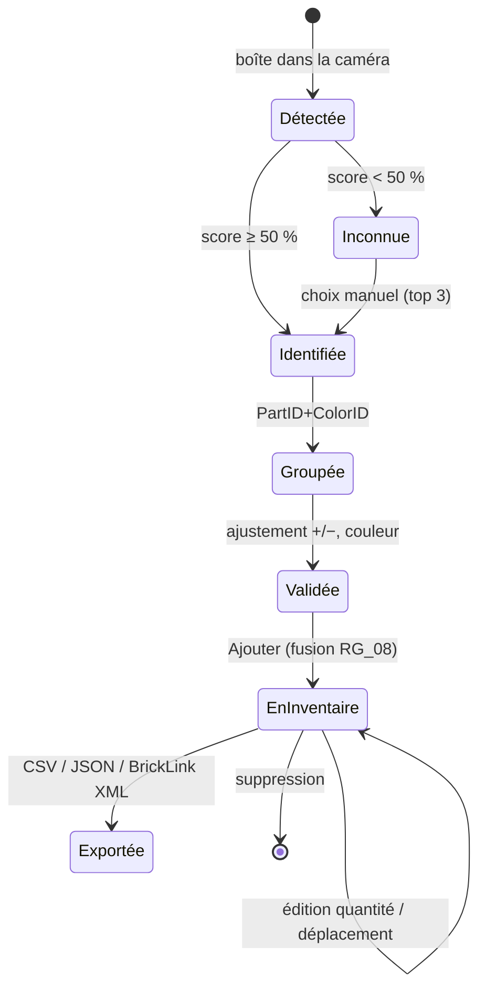

# Spécifications fonctionnelles — BrickHeap V1

Statut : **validées pour la V1** (révision du 2026-11-15). Le plan d'implémentation [`IMPLEMENTATION_PLAN.md`](IMPLEMENTATION_PLAN.md) (révision 2) fait foi pour les choix techniques ; les maquettes sont dans `UX_UI_MOCKUPS.md`.

Convention : `RG_` règle de gestion · `EX_` exigence · `RT_` règle technique.

## 1. Modes de scan

Un sélecteur en bas d'écran (zone du pouce) bascule à la volée entre **Explorer** et **Inventorier** sans quitter la caméra ni perdre la détection en cours.

### 1.1 Scan unitaire vs pile

- RG_01 — Une scène avec 1 boîte détectée est un scan unitaire ; ≥ 2 boîtes est une pile. L'UI est identique, seul le tiroir apparaît (« X pièces détectées »).
- RG_02 — Détection multi-objets : chaque boîte reçoit un identifiant de suivi stable entre frames (IoU ≥ 0,5).
- RG_03 — Chevauchements : si deux boîtes ont IoU > 0,6 elles sont fusionnées (NMS) en gardant le meilleur score. Une pièce **coupée par le bord de l'image** est marquée « partielle » et exclue du comptage automatique en Inventorier (proposée à confirmation). V1 : l'occultation par une autre pièce (« visible à < 40 % ») n'est pas mesurée.
- RG_04 — Seuils de confiance sur la **confiance calibrée** (score Brickognize brut converti par une courbe définie dans `src/domain/pile/thresholds.ts`, ajustée avec le mode Calibration) :
  - ≥ 80 % : acceptée (contour vert) ;
  - 50–79 % : « à vérifier » (contour orange), proposition des **3 correspondances** visuelles les plus proches ;
  - < 50 % : « inconnue » (contour gris), jamais ajoutée sans choix explicite.
  - Interprétation V1 : les pièces « à vérifier » sont comptées ; « Ajouter » vaut confirmation (le pied de page indique « dont N à vérifier »).
- RG_05 — Regroupement automatique par clé `PartID + ColorID` ; la quantité = nombre de boîtes acceptées/confirmées de cette clé.
- RG_06 — Une pièce sans couleur fiable reste groupée à part (« couleur à confirmer ») et doit être corrigée avant l'ajout : « Confirmer {couleur} » (un toucher) sur la ligne, « Tout confirmer », ou sélecteur de couleur qui montre la photo de la pièce et la couleur mesurée.
- RG_07 — Les limites matérielles (pièces empilées, cachées) rendent le comptage approximatif : l'UI affiche « ≈ » et invite à ajuster avec `+ / −`.

### 1.2 Mode Explorer (scan rapide)

- EX_01 — Aperçu caméra fluide ; cadres mis à jour par instantanés (toutes les 2–3 s, limite d'Expo Go) ; identification asynchrone des pièces stables.
- EX_02 — Toucher une boîte ouvre la fiche pièce ; rien n'est enregistré.
- EX_03 — Tiroir rétractable listant les pièces visibles ; toucher une ligne surligne la boîte et ouvre la fiche.
- EX_04 — Aucune écriture en base ; uniquement le cache catalogue.

### 1.3 Mode Inventorier

- EX_05 — Bouton déclencheur : capture figée de la pile (haute résolution), identification de toutes les boîtes.
- EX_06 — Vue de validation : lignes groupées (`3× Brique 2×4 Rouge`), vignette (photo de la pièce réelle pour les lignes à décider), pastille couleur, badge de confiance, `+ / −` et quantité saisissable, changement de couleur, suppression, ouverture de la fiche.
- EX_07 — Bouton « Ajouter à l'inventaire » (un clic) vers la liste choisie (par défaut : dernière liste utilisée).
- RG_08 — Ajout = fusion : si `(liste, PartID, ColorID)` existe, la quantité est incrémentée, sinon une ligne est créée. La synchronisation additionne les écarts de quantité (jamais « le dernier gagne »). La suppression d'une liste est définitive : les pièces ajoutées hors ligne à cette liste sur un autre appareil disparaissent avec elle.
- RG_09 — Scanner plusieurs vues de la même pile peut doubler les comptes : l'utilisateur voit un avertissement « déjà ajouté depuis cette session » et peut annuler (undo 10 s).

### 1.4 Ergonomie caméra

- EX_08 — Torche/flash, verrouillage de mise au point (tap long), permissions caméra expliquées avant la demande système ; refus → écran explicatif avec accès aux réglages.
- EX_09 — Repli réseau : si Brickognize est indisponible, les boîtes restent affichées en gris (« identification indisponible, réessayer »), jamais de blocage de l'écran.

### 1.5 Mode Calibration / Vérité terrain

- EX_10 — Activable dans Réglages (discret). Affiche côte à côte « détecté » vs « attendu » : l'utilisateur saisit la liste attendue (`PartID/ColorID × qté`).
- EX_11 — Métriques : précision, rappel, écart de comptage ; export JSON local d'une session. Le fichier exporté ne contient aucune image ni donnée personnelle ; l'identification d'un scan de calibration passe par Brickognize comme un scan normal.

## 2. Fiche pièce

- EX_12 — Identité : nom affiché en français (premiers mots traduits, ex. « Brique 2 x 4 ») et nom officiel anglais, Design ID, Element ID (pour la couleur), couleur (nom + pastille hex exacte), catégorie (en français), dimensions (déduites du nom, « — » si inconnues).
- EX_13 — Bouton « Rechercher sur Pick a Brick » → `https://www.lego.com/fr-fr/pick-and-build/pick-a-brick?query=[ID]`, où `ID` = Element ID quand la couleur est connue, sinon Design ID.
- EX_14 — Sets compatibles contenant la pièce **dans cette couleur** : visuel, numéro, année ; la quantité dans un set s'affiche à la demande (toucher la ligne). Filtres année et nom appliqués aux pages chargées (« {chargés} sur {total} sets chargés », une page supplémentaire chargée automatiquement quand un filtre ne trouve rien, bouton « Charger plus ») ; liste scrollable.
- RT_01 — Données via Edge Function `catalog-proxy` avec cache Supabase ; états chargement/erreur/vide gérés.

## 3. Inventaire

- EX_15 — Vue grille par défaut : chaque référence est une **vignette (image de la brique) avec un badge de quantité en haut à droite de l'image** (le nom en français et la couleur en dessous). La vignette montre l'image de la pièce dans sa couleur quand elle est connue, sinon l'image générique avec une pastille de la vraie couleur. Vue liste en alternative, regroupement par catégorie (noms en français), couleur ou liste ; filtres (couleur, catégorie, recherche avec ou sans accents).
- EX_16 — Édition de quantité (boutons `+ / −` ou saisie directe en touchant la valeur), déplacement entre listes, suppression avec annulation.
- EX_17 — Listes/projets personnalisés (« Vrac Salon », « Projet MOC »).
- EX_18 — Export : **CSV**, **JSON**, **BrickLink XML** (`<INVENTORY><ITEM><ITEMTYPE>P</ITEMTYPE><ITEMID/><COLOR/><MINQTY/></ITEM></INVENTORY>`, couleur au format BrickLink via table de correspondance), partage via la feuille de partage native.
- RG_10 — Quantité entière ≥ 1 ; passer à 0 supprime la ligne.
- RG_14 — Référence provisoire : une pièce reconnue par Brickognize mais pas encore (ou pas du tout) trouvée dans le catalogue Rebrickable est conservée sous son identifiant Brickognize, avec son nom et son image, puis rapprochée automatiquement de la référence catalogue dès que possible. Tant que ce rapprochement est en attente, elle n'est pas synchronisée.

## 4. Cycle de vie d'une pièce

## 5. Compte & navigation

- EX_19 — Navigation par barre d'onglets : Scanner, Inventaire, Listes, Compte. Premier lancement : écran d'accueil (Créer un compte / Se connecter / Continuer sans compte).
- EX_20 — Authentification Supabase Auth, V1 : e-mail + mot de passe (≥ 8 caractères) et code à 6 chiffres reçu par e-mail (confirmation d'inscription, « code de connexion », réinitialisation du mot de passe). Sign in with Apple et Google sont reportés à la phase « development build » (impossibles dans Expo Go) et seront livrés ensemble (Apple est obligatoire sur iOS dès qu'un login social existe).
- EX_21 — Inscription : pseudo optionnel, validation e-mail, acceptation des CGU/politique de confidentialité, e-mail de confirmation.
- EX_22 — Mot de passe oublié : message identique que le compte existe ou non (pas d'énumération de comptes).
- EX_23 — Compte : profil, changement de mot de passe, état de synchronisation, déconnexion, export des données, **suppression de compte** (confirmation, effacement des données synchronisées). Supprimer le compte efface aussi l'inventaire local de cet appareil ; « Exporter d'abord » est proposé.
- RG_11 — Mode sans compte : tout fonctionne en local. À la création/connexion d'un compte, l'inventaire local est fusionné (RG_08) dans le compte ; en cas de conflit, la plus grande quantité n'est pas supposée : les quantités sont additionnées après confirmation. Trois choix sont proposés : « Fusionner », « Garder uniquement mon compte », « Annuler ».
- RG_12 — Session persistante (jeton rafraîchi automatiquement, au premier plan) ; expiration → reconnexion sans perte de données locales. Être hors ligne avec un jeton expiré n'est pas une session expirée. Issues proposées : « Se connecter » ou « Conserver ces données sur cet appareil (mode sans compte) ».
- RG_13 — Erreurs d'authentification : message clair + issue (réessayer, mot de passe oublié, continuer sans compte).
- RT_02 — Clé de chiffrement stockée dans `expo-secure-store`, session chiffrée (AES-GCM) dans le stockage local ; aucune donnée personnelle hors e-mail/pseudo.

## 6. Critères d'acceptation (extraits)

- Ouverture app → caméra active en < 3 s.
- Une pile de 20 pièces simples bien séparées : ≥ 80 % identifiées correctement en conditions normales de lumière (mesuré avec le mode Calibration sur appareils réels).
- Aucune clé API dans le bundle hors `EXPO_PUBLIC_*`.
- Accessibilité : labels VoiceOver/TalkBack sur toutes les actions, cibles ≥ 48 dp, information jamais portée par la seule couleur (icône + texte en plus du contour).
