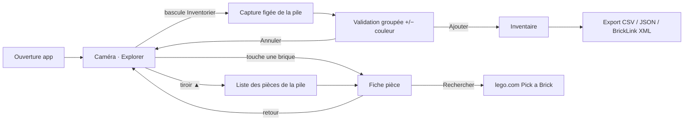
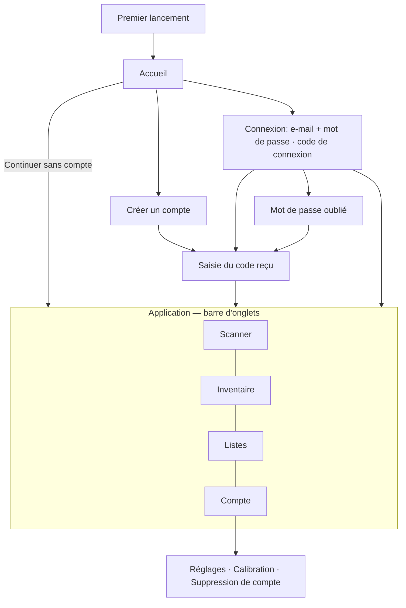

# UX/UI — BrickHeap V1

Aperçu visuel : ouvrez [mockups-preview.html](mockups-preview.html) dans un navigateur.

## 1. Identité visuelle

**Logo conceptuel** : un tas de trois briques stylisées (vues de dessus, tenons ronds) en pyramide irrégulière, la brique du sommet portant un cadre de visée `⌜ ⌝`. Wordmark « BrickHeap » en minuscules grasses. (Pas de reproduction de la marque LEGO.)

**Palette (contraste élevé sur table colorée)** — l'UI caméra est sombre pour que les cadres ressortent sur n'importe quelle couleur de brique :

| Rôle | Hex | Usage |
|---|---|---|
| Fond / encre | `#12141A` | Barres, tiroir, texte sur clair |
| Surface | `#1E222B` | Cartes, tiroir |
| Texte | `#F5F6F8` | Texte principal (contraste 15:1 sur fond) |
| Primaire (jaune brique) | `#FFD02E` | Action principale, déclencheur |
| Confiance haute | `#2BD96B` | Contour ≥ 80 % |
| À vérifier | `#FF9F1C` | Contour 50–79 % |
| Inconnue | `#9AA3B2` | Contour < 50 % |
| Erreur | `#FF4D4F` | Erreurs |

Chaque contour a **double trait** (blanc 3 px + couleur de statut 2 px) et une icône (✓ / ? / –) : lisible sur rouge, jaune ou vert, et pour les daltoniens.

**Typographie** : Inter (système en repli) — titres 700, corps 400/16 px, chiffres tabulaires pour les quantités.

**Thumb Zone** : toutes les actions fréquentes en bas d'écran ; les infos en haut sont en lecture seule.

```
┌──────────────┐ zone lecture (haut)
│  torche  ⓘ   │
│              │
│   caméra     │ zone atteignable avec effort
│              │
│ [tiroir ▲]   │
│ ◀Explorer|Inventorier▶ │ zone naturelle du pouce
│      (⬤)     │
└──────────────┘
```
Cibles ≥ 48 dp ; encoche/Dynamic Island et barre de navigation gérées par `SafeAreaView`.

## 2. User flows



Bascule fluide : le switch ne réinitialise pas la caméra ; la détection en cours de la pile est conservée et, en Inventorier, le déclencheur fige cette même scène.

## 2bis. Navigation & compte

**Barre d'onglets basse** (4 entrées) : **Scanner · Inventaire · Listes · Compte**. La barre d'onglets est masquée sur les écrans empilés : validation, fiche pièce, export, réglages, profil. L'onglet actif est jaune + gras (jamais la couleur seule). Réglages, export de données, mentions légales et suppression de compte sont dans **Compte**. L'export d'une liste est accessible depuis Inventaire et Listes.



**Mode sans compte** : l'usager n'est jamais bloqué ; l'inventaire reste local et un bandeau propose de créer un compte, ce qui migre les données locales vers Supabase.

## 3. Écrans

Écrans d'accès/compte (maquettes A1–A6) : accueil, connexion, inscription (avec erreurs de champ), mot de passe oublié, compte, réglages avec suppression de compte (exigée par les stores).

- **A2 Connexion** : e-mail + mot de passe, « Recevoir un code de connexion » (remplace le lien magique). Pas de bouton Apple ni Google en V1 (reportés à la phase « development build »).
- **Saisie du code** (nouvel écran) : 6 chiffres reçus par e-mail, utilisé pour la confirmation d'inscription, le code de connexion et la réinitialisation du mot de passe ; « Renvoyer le code » après 60 s.
- **A4 Mot de passe oublié** : après envoi, « Saisir le code reçu » ouvre l'écran de saisie du code.
- **A6 Réglages** : « Sync Wi-Fi uniquement » est retiré ; « Explorer en direct » est ajouté (désactivé → bouton « Analyser »).

### 3.1 Scanner AR multi-briques
Plein écran. Cadres interactifs par brique (double trait + icône de statut + libellé court « 2×4 Rouge · 92 % »). Haut : torche, verrou de focus, réglages. Bas : tiroir replié (« 7 pièces détectées ▲ »), switch Explorer/Inventorier, déclencheur jaune (Inventorier) ou indicateur de scan (Explorer).

**B1 — mode direct par instantanés** : l'aperçu caméra est fluide, mais Expo Go n'expose pas les images de l'aperçu ; les cadres sont recalculés à partir d'une photo silencieuse prise toutes les 2–3 s (jusqu'à 6 s sur un téléphone lent). Seules les pièces vues sur deux instantanés consécutifs sont identifiées.

### 3.2 Tiroir récapitulatif de pile
Rétractable (3 hauteurs : replié, mi-hauteur, plein). Lignes : vignette, nom, pastille couleur, ×qté, badge de confiance. Toucher = surligne la boîte + ouvre la fiche. Statut « à vérifier » : chip orange ouvrant les 3 propositions visuelles.

### 3.3 Validation (Inventorier)
Écran empilé **sans barre d'onglets** (B3 redessinée). Liste groupée `3× Brique 2×4 Rouge`, `+ / −` de 48 dp et quantité saisissable, pastille couleur cliquable (sélecteur de couleur avec la photo de la pièce et la couleur mesurée en tête), bandeau « ≈ comptage approximatif ». Les lignes à décider (inconnue, pièce coupée, couleur à confirmer) montrent en vignette la photo recadrée de la pièce réelle. Ligne « Couleur à confirmer » : bouton « Confirmer {couleur} » en un toucher, et « Tout confirmer » en tête de liste. Barre d'action fixe en bas : **Ajouter 12 pièces à [Vrac Salon ▾]**, avec « dont N à vérifier » et le nombre de pièces ignorées.

### 3.4 Fiche pièce officielle
Écran empilé avec chevron retour et **sans barre d'onglets** (C1 redessinée). En-tête : image, nom en français et nom officiel, pastille hex + nom de couleur. Blocs : Design ID / Element ID, catégorie, dimensions. CTA principal « Rechercher sur Pick a Brick ». Section « Sets compatibles » (recherche + filtre année, cartes avec visuel, n°, année, quantité).

### 3.5 Inventaire & filtres
Grille de vignettes : image de la brique (fond clair neutre pour la lisibilité des couleurs), **badge jaune du nombre en haut à droite de l'image** (`99+` au-delà), nom et couleur dessous. Onglets de listes en haut, bascule grille/liste, regroupement (catégorie · couleur · liste), filtres en feuille basse (couleur, catégorie, recherche), compteur total de pièces.

**C3 Listes** : chaque liste a un bouton « ⋯ » qui ouvre ses actions (renommer, exporter, supprimer) ; pas de geste de glissement.

### 3.6 Export
Feuille basse : choix CSV / JSON / BrickLink XML, périmètre (liste courante / tout), bouton « Partager ». Confirmation avec nombre de lignes exportées.

## 4. États à concevoir
Chargement (squelettes), hors-ligne / service d'identification indisponible (cadres gris + message avec « Réessayer »), permission caméra refusée (explication + bouton Réglages), pile vide (« Pointez la caméra vers vos briques »), erreurs catalogue.

## 5. Accessibilité
Contraste ≥ 4,5:1, statut jamais seulement par la couleur, labels VoiceOver/TalkBack (« Brique 2×4 rouge, 92 %, appuyer pour ouvrir »), texte dynamique, retours haptiques sur ajout/undo.
